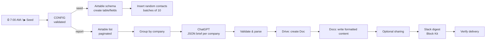

# Airtable → ChatGPT Company Briefs → Google Docs → Slack

An n8n workflow that keeps a contact list in Airtable. Every morning at 7:00 AM it writes an AI brief for each company in that list, saves each brief as a Google Doc, and posts a digest to Slack with links to the Docs.

**Case study:** [harshith-nayaka-l-portfolio.vercel.app/work/airtable-ai-company-briefs](https://harshith-nayaka-l-portfolio.vercel.app/work/airtable-ai-company-briefs): the problem, the architecture and the engineering decisions behind this workflow.

**One import. One CONFIG node to fill. No code changes.**

---

## What it does

| Step | What happens |
|---|---|
| **▶ Seed Contacts** (manual) | Creates the `Contacts` table (Name / Email / Company Name) if it doesn't exist and inserts random contacts at real companies. |
| **⏰ Daily 7:00 AM** | Reads every contact (paginated). Groups contacts by company. Asks ChatGPT for a structured brief on each company. |
| **Google Docs** | Creates one Google Doc per company, containing the company name and the summary (Overview, Products & services, Market, Business model, Notable facts, Sales angle, Contacts). |
| **Slack** | Posts one digest to a channel, with a link to each Doc, a confidence level, and any issues found during the run. |



## Setup (about 10 minutes)

1. **Import** `airtable-ai-company-briefs.json`: n8n → Workflows → ⋯ → *Import from file*.
2. **Create the credentials** in n8n:
   | Credential type | Notes |
   |---|---|
   | Airtable Personal Access Token API | Scopes: `data.records:read`, `data.records:write`, `schema.bases:read`, `schema.bases:write`. Give it access to your base. |
   | OpenAI | API key from platform.openai.com |
   | Google Docs OAuth2 API | Enable the **Google Docs API** and **Google Drive API** in Google Cloud. Redirect URI: `http://localhost:5678/rest/oauth2-credential/callback` |
   | Slack API | Bot token (`xoxb-…`) with `chat:write`. Invite the bot to the channel: `/invite @YourBot` |
3. **Select those credentials** on the HTTP nodes that show a ⚠️.
4. **Open the `CONFIG` node** and fill in:
   | Key | Example |
   |---|---|
   | `airtable.baseId` | `appXXXXXXXXXXXXXX` (from the base URL) |
   | `slack.channelId` | `C0123ABCD45` (channel name → *View channel details*) |
   | `openai.model` | `gpt-5.4-mini` (default; works with any Chat Completions model) |
   | `report.sharing` | `none` · `anyone_with_link` · `domain:yourco.com` |
5. Click **▶ Seed Contacts** once.
6. Run the **⏰ Daily 7:00 AM** trigger manually to test it, then **Publish/activate** the workflow.

The schedule uses the workflow timezone (`Asia/Kolkata` by default; change it in *Settings*).

## Why it's hard to break

- **Validates its own config.** A placeholder ID, a wrong ID format, or a `#channel-name` where an ID is expected stops the run at CONFIG, with a message that names the fix.
- **Every API response is checked.** HTTP errors come back as data and are translated into fixes, e.g. *"token needs schema.bases:write"*, *"enable the Google Drive API"*, *"/invite the bot"*.
- **One company's failure doesn't sink the run.** A ChatGPT timeout, a truncated answer or a Docs error is listed in the Slack digest, and every other company is still delivered.
- **A total failure fails loudly.** If every summary fails, the run errors instead of "succeeding" with nothing, which triggers the error-alert workflow.
- **AI output is treated as untrusted.** It's requested in JSON mode, then parsed (handling ```` ``` ```` fences), checked for truncation or refusal, and validated before anything is written.
- **No duplicates or double billing.** Write and AI calls are never retried automatically. Reads retry three times on network errors.
- **Respects API limits.** Airtable writes go in batches of 10 at 5 requests/second, and Slack messages stay within 50 blocks and 3,000 characters per section.

## Tested

- Validated against a strict mock of Airtable, OpenAI, Drive, Docs and Slack inside a real n8n instance. Scenarios covered:
  - happy path
  - pagination
  - partial OpenAI failures (500, truncated output, fenced JSON, dropped connection)
  - Doc create and write failures
  - Drive API disabled
  - bot not in channel
  - empty or missing table
  - placeholder config
  - company cap
- Live run on n8n 2.8.4 with real accounts:
  - 10 contacts seeded
  - 7 companies summarised (`gpt-5.4-mini`)
  - 7 Google Docs created
  - digest posted to Slack

## Related

- [youtube-scraper-google-sheets-n8n](https://github.com/HarshithNayakaL/youtube-scraper-google-sheets-n8n)
- [slack-weekly-report-bot-n8n](https://github.com/HarshithNayakaL/slack-weekly-report-bot-n8n) (also holds the shared error-alert workflow)
